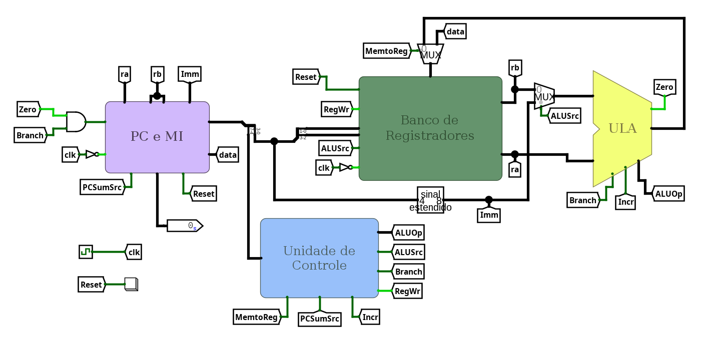
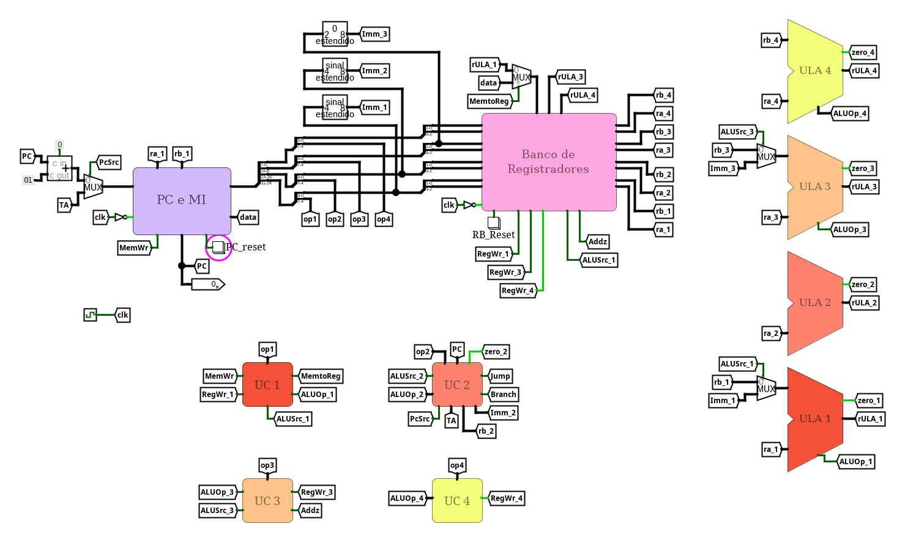

# Arquitetura e Organização de Computadores (CI1212)

Trabalhos práticos desenvolvidos para a disciplina de **Arquitetura e Organização de Computadores** da UFPR.

Os enunciados completos estão em [`enunciados/`](enunciados/).

Os relatórios das implementações dos trabalhos 2 e 3 estão nas suas respectivas pastas.

- **Trabalho 1**: Soma de vetores em assembly, arquitetura [REDUX-V](https://egg.gboncoffee.dev.br/docs/en/#redux-v), trabalho individual
- **Trabalho 2**: Processador monociclo, arquitetura [REDUX-V](https://egg.gboncoffee.dev.br/docs/en/#redux-v), trabalho individual
- **Trabalho 3**: Vetorial e VLIW, arquitetura [SAGUI](https://egg.gboncoffee.dev.br/docs/en/#sagui), trabalho em dupla

## Imagens

## Créditos

Trabalhos idealizados pelo professor **Marco Zanata** da UFPR.

Emulador [EGG](https://github.com/gboncoffee/egg) desenvolvido pelo aluno **Gabriel de Brito** da UFPR.

Trabalhos 1 e 2 implementados por **Isabella dos Santos Stuart**. Trabalho 3 em dupla com **Maria Eduarda Prada**.
